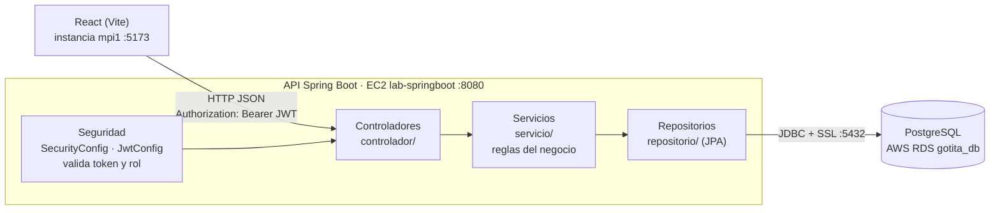
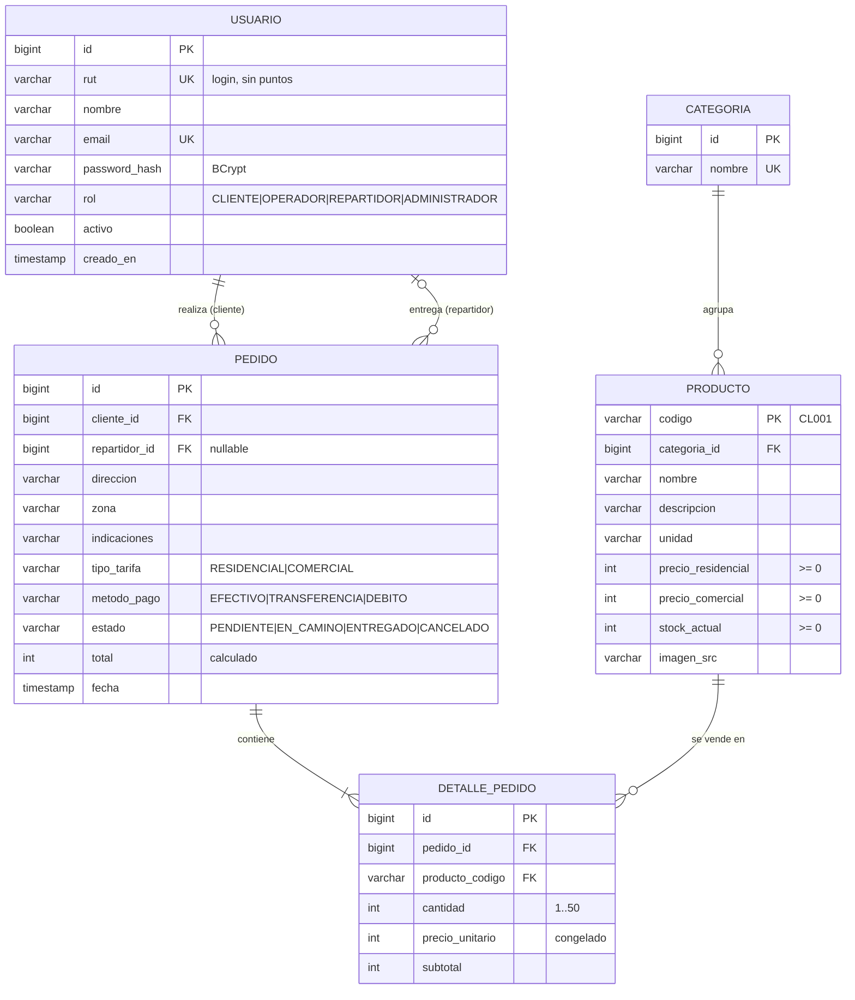
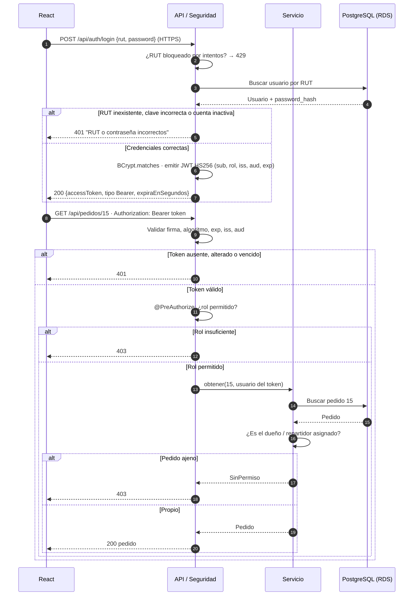

# Gas Gotita — Backend (API REST)

API REST de **Distribuidora de Gas Gotita**, proyecto semestral de **DSY1104 Desarrollo Fullstack II** (Duoc UC, 2026).
Reemplaza los datos simulados en `localStorage` del frontend por una base de datos real y agrega inicio de sesión seguro con JWT.

| | |
|---|---|
| **Caso** | Distribuidora de gas licuado en Chillán (Ñuble): pedidos de cilindros y accesorios, asignación a repartidores y entrega |
| **Sección** | _(completar)_ |
| **Integrantes** | Martín Escobar · Rocío Sáez |
| **Frontend (React)** | https://github.com/martinlabjkpsm-cpu/Distribuidora-de-Gas-Gotita |
| **Guía** | Guía 19 — Plan de trabajo: backend, base de datos e inicio de sesión con JWT |

**Funcionalidades que cubre el backend:** catálogo y detalle de productos, categorías, registro e inicio de sesión, pedido de gas (operación principal), seguimiento e historial por rol, asignación de repartidor, cambio de estado de la entrega, "dinero a rendir" del repartidor y administración de usuarios, productos y categorías.

---

## 1. Decisiones técnicas

| Decisión | Elección | Justificación |
|---|---|---|
| Lenguaje y framework | **Java 21 + Spring Boot 4.1** | Ya trabajado en la guía 17; tipado fuerte; Spring trae resueltos REST, acceso a datos, validación y seguridad. |
| Ejecución | **EC2** (instancia Ubuntu `lab-springboot`, puerto 8080) | Proceso Java de larga duración con conexión permanente a la base; sin arranques en frío como Lambda. El proceso se inicia con `./mvnw spring-boot:run` (desarrollo) o como servicio `systemd` con `java -jar`, que lo mantiene activo y lo reinicia si se cae (ver §8). |
| Base de datos | **PostgreSQL 18 en AWS RDS** (`gotita-db`, base `gotita_db`) | Relacional (pedidos ↔ productos ↔ usuarios con claves foráneas), datos persistentes fuera de la EC2, respaldos gestionados por AWS. La EC2 accede por la red privada de la VPC con una regla de entrada al puerto 5432 que solo admite el grupo de seguridad de `lab-springboot`. |

**Alternativas evaluadas y descartadas**

| Alternativa | Por qué no |
|---|---|
| Node.js (Express) en EC2 | Viable, pero el equipo ya trabajó Spring Boot en la guía 17 y Spring trae integrados JPA, validación, BCrypt y la validación de JWT; en Node habría que combinar varias bibliotecas (Express, Prisma/Sequelize, bcrypt, jsonwebtoken, express-validator). |
| Node.js en AWS Lambda + API Gateway | Exige dividir la API en funciones y manejar la conexión a RDS en cada invocación (arranques en frío, límite de conexiones o RDS Proxy). Para una app con sesiones de pedidos frecuentes y un solo equipo, un proceso permanente en EC2 es más simple de operar y depurar. |
| Spring Boot en Lambda | Los arranques en frío de la JVM son lentos y el empaquetado es más complejo; no aporta ventajas para este caso. |

| Componente | Para qué se usa |
|---|---|
| `spring-boot-starter-webmvc` | Controladores REST y respuestas JSON |
| `spring-boot-starter-data-jpa` + Hibernate | Acceso a datos: entidades y repositorios sin SQL manual |
| `org.postgresql:postgresql` | Driver JDBC de PostgreSQL |
| `spring-boot-starter-validation` | Validación de entrada (`@NotBlank`, `@Email`, `@Min`…) → 400 |
| `spring-boot-starter-security` | Filtros de seguridad, permisos por rol (`@PreAuthorize`), **BCrypt** |
| `spring-security-oauth2-resource-server` + `-jose` (Nimbus) | Emitir y validar el **JWT** (firma, algoritmo, `exp`, `iss`, `aud`) |
| `springdoc-openapi-starter-webmvc-ui` | Especificación **OpenAPI** y **Swagger UI** |
| JUnit 5 (`spring-boot-starter-webmvc-test`) | Pruebas unitarias; Swagger UI / Postman para probar la API |

---

## 2. Arquitectura y responsabilidades



| Capa (paquete) | Responsabilidad |
|---|---|
| `controlador/` | Recibe la solicitud HTTP, valida el formato con `@Valid`, aplica el permiso por rol (`@PreAuthorize`) y devuelve el estado HTTP (200/201/204). |
| `servicio/` | Reglas del negocio y transacciones: precios según tarifa, total, stock, transiciones de estado, propiedad de los pedidos, unicidad de RUT/correo. |
| `repositorio/` | Consultas y cambios en la base (Spring Data JPA). Bloqueo de fila al descontar stock. |
| `modelo/` | Entidades persistentes (tablas). |
| `dto/` | Campos que la API acepta y devuelve. Nunca exponen `password_hash`. |
| `seguridad/` | BCrypt, emisión y validación del JWT, CORS, límite de intentos de login, validación de RUT. |
| `excepcion/` | Traduce errores a JSON con 400/401/403/404/409/429. |
| `config/` | Swagger/OpenAPI y carga de datos iniciales. |

**Responsabilidades del equipo** _(ajustar)_: Martín Escobar — base de datos, seguridad JWT y despliegue en EC2. Rocío Sáez — endpoints de catálogo y pedidos, integración de los `services/` del frontend y pruebas.

---

## 3. Diseño de datos



> Diagrama en Drive (export del diagrama anterior): _(pegar enlace con acceso de lectura para el docente)_

**Decisiones del modelo**
- Un pedido tiene **dos relaciones con usuario**: el cliente que lo pide (obligatoria) y el repartidor asignado (opcional hasta que la operadora lo asigna).
- `detalle_pedido.precio_unitario` guarda el precio **al momento de la compra**: si después cambia el catálogo, el pedido histórico no cambia.
- El rol es un valor de la tabla `usuario` (un rol por persona, como en el ERS), no una tabla aparte.
- Los precios son enteros en pesos chilenos (CLP no usa decimales).

**Reglas de integridad**

| Regla | Dónde se aplica |
|---|---|
| RUT y correo no se repiten | `UNIQUE` en la tabla + 409 en el servicio |
| Código de producto y nombre de categoría no se repiten | PK / `UNIQUE` + 409 |
| Precios y stock ≥ 0; cantidad entre 1 y 50 | Validación (400) y servicio |
| El stock nunca queda negativo | `PedidoService.crear`: bloqueo de fila + 409 "Stock insuficiente" |
| Un pedido siempre tiene cliente y al menos un detalle | `NOT NULL` + `@NotEmpty` |
| Eliminar una categoría con productos | Prohibido → 409 |
| Eliminar un producto que ya se vendió | Prohibido → 409 (se conserva el historial) |
| Eliminar un pedido | Solo ADMINISTRADOR; borra sus detalles en cascada y devuelve el stock si no estaba entregado |
| Cancelar un pedido | Solo desde PENDIENTE; devuelve el stock |

**Datos iniciales.** `config/DatosIniciales.java` traspasa a la base los datos simulados del frontend (`src/data/catalogoGasGotita.js`): 4 categorías y 14 productos, **solo si las tablas están vacías**. Con `ddl-auto=update` las tablas y los datos **se mantienen al reiniciar** el backend. Los 4 usuarios de prueba (uno por rol) se crean solo si existe la variable `DEMO_PASSWORD`, de modo que ninguna contraseña queda en el repositorio.

---

## 4. Relación con el frontend

| Pantalla (React) | Función actual en `services/` | Endpoint |
|---|---|---|
| Catálogo, Inicio, Ofertas | `listarProductos()` | `GET /api/productos` |
| Detalle de producto | `obtenerProducto(codigo)` | `GET /api/productos/{codigo}` |
| Categorías | `listarCategorias()` | `GET /api/categorias` |
| Login | `usuarioService.autenticar(rut, pass)` | `POST /api/auth/login` |
| Registro | `usuarioService.crearUsuario(...)` | `POST /api/auth/register` |
| Sesión (AuthContext) | lectura de `usuario_gas_el_volcan` | `GET /api/auth/me` |
| Cliente → confirmar pedido | `pedidoService.crearPedido(...)` | `POST /api/pedidos` |
| Mis pedidos / resultado | `listarPorCliente(rut)`, `obtenerPedido(id)` | `GET /api/pedidos`, `GET /api/pedidos/{id}` |
| Operadora | `getPedidos()`, `asignarRepartidor(...)` | `GET /api/pedidos?estado=`, `GET /api/usuarios/repartidores`, `PATCH /api/pedidos/{id}/repartidor` |
| Repartidor | `cambiarEstado(id, estado)` | `PATCH /api/pedidos/{id}/estado`, `GET /api/pedidos/rendicion` |
| Admin → productos / categorías | `crearProducto`, `actualizarProducto`, `eliminarProducto`, `...Categoria` | `POST/PUT/DELETE /api/productos`, `/api/categorias` |
| Admin → usuarios | `getUsuarios`, `crearUsuario`, `actualizarUsuario`, `cambiarActivo` | `GET/POST /api/usuarios`, `PATCH /api/usuarios/{rut}/rol`, `/activo` |

**Cómo el frontend encuentra la API.** React leerá la URL base desde `VITE_API_URL` (archivo `.env` del frontend, ej. `VITE_API_URL=http://localhost:8080`) y cada service hará ``fetch(`${import.meta.env.VITE_API_URL}/api/productos`)``. En desarrollo, VS Code reenvía el puerto 8080 de `lab-springboot` a `localhost:8080` del computador del desarrollador, y el 5173 del frontend a `localhost:5173`, por eso CORS permite ese origen. Para que otra persona use la app sin VS Code habrá que publicar la API (IP pública o dominio con HTTPS, puerto abierto en el grupo de seguridad) y agregar ese origen a `CORS_ORIGINS`.

**Estados de la interfaz** (pendiente de implementar en React): *cargando* (spinner mientras llega la respuesta), *vacío* ("No tienes pedidos"), *error de validación* (400 → mostrar `campos` bajo cada input), *sesión vencida* (401 → borrar token y redirigir a `/login`), *sin permiso* (403 → `/sin-acceso`), *conflicto* (409 → mensaje del servidor, ej. "Stock insuficiente…").

### Recorrido de la operación principal: crear un pedido

1. **React** (`ClientePage` → `FormularioPedido`) valida nombre, dirección, zona y método de pago y llama `POST /api/pedidos` con `Authorization: Bearer <token>`.
2. **Seguridad** valida el JWT y que el rol sea CLIENTE o ADMINISTRADOR; si no, 401 o 403.
3. **Controlador** aplica `@Valid` al cuerpo: items no vacíos, cantidad 1–50, dirección ≥ 5 caracteres, tarifa y pago válidos; si falla, 400.
4. **Servicio** (`PedidoService.crear`, una transacción): toma el **cliente desde el token**, bloquea cada producto, comprueba stock (409 si falta), pone el **precio según la tarifa**, calcula subtotales y **total**, descuenta stock y deja el estado en **PENDIENTE**.
5. **Repositorio** inserta `pedido` y `detalle_pedido` en PostgreSQL. Si algo falla, se revierte todo.
6. **Respuesta** 201 con el pedido creado; React vacía el carrito y navega a `/pedido/{id}`.

| Campo | Lo envía el cliente | Lo calcula el servidor |
|---|---|---|
| items (código, cantidad), tipoTarifa, dirección, zona, indicaciones, metodoPago | ✔ | |
| cliente (RUT, nombre) | | ✔ desde el JWT |
| precioUnitario, subtotal, total | | ✔ desde el catálogo |
| estado, fecha, id | | ✔ |

**Validaciones de "crear pedido" por responsabilidad**

| Validación | React | Controlador (`@Valid`) | Servicio | Base de datos |
|---|---|---|---|---|
| Campos obligatorios y formato (dirección ≥ 5, zona, pago) | ✔ ayuda al usuario | ✔ 400 | | `NOT NULL` |
| Al menos un producto; cantidad 1–50 | ✔ | ✔ 400 | | |
| Tarifa y método de pago dentro de los valores permitidos | ✔ | ✔ 400 (enum) | | |
| Token válido y rol CLIENTE/ADMINISTRADOR | (ruta protegida) | Seguridad 401/403 | | |
| El producto existe | | | ✔ 400 | FK `producto_codigo` |
| Hay stock suficiente | | | ✔ 409 (con bloqueo de fila) | |
| Precio según tarifa, subtotal y total | (solo muestra) | | ✔ lo calcula | |
| Cliente = usuario del token | | | ✔ | FK `cliente_id` |

---

## 5. API y documentación viva

**Swagger UI:** `http://<IP-pública-de-lab-springboot>:8080/swagger-ui.html` (o `http://localhost:8080/swagger-ui.html` con el puerto reenviado por VS Code).
**OpenAPI JSON:** `/v3/api-docs`. Para probar rutas protegidas: hacer login, copiar `accessToken` y pegarlo en el botón **Authorize**.

| Método y ruta | Acceso | Entrada | Éxito | Errores | Estado |
|---|---|---|---|---|---|
| `GET /api/estado` | Público | — | 200 `{api, baseDatos}` | — | Implementado |
| `POST /api/auth/register` | Público | rut, nombre, email, password | 201 usuario (rol CLIENTE) | 400, 409 | Implementado |
| `POST /api/auth/login` | Público | rut, password | 200 `{accessToken, tipo, expiraEnSegundos, usuario}` | 400, 401, 429 | Implementado |
| `GET /api/auth/me` | Autenticado | — | 200 usuario | 401 | Implementado |
| `GET /api/categorias` | Público | — | 200 lista | — | Implementado |
| `POST /api/categorias` · `PUT /{id}` · `DELETE /{id}` | ADMINISTRADOR | nombre | 201 · 200 · 204 | 400, 401, 403, 404, 409 | Implementado |
| `GET /api/productos?categoria=` | Público | — | 200 lista | — | Implementado |
| `GET /api/productos/{codigo}` | Público | — | 200 producto | 404 | Implementado |
| `POST /api/productos` · `PUT /{codigo}` · `DELETE /{codigo}` | ADMINISTRADOR | producto | 201 · 200 · 204 | 400, 401, 403, 404, 409 | Implementado |
| `POST /api/pedidos` | CLIENTE, ADMINISTRADOR | items, tipoTarifa, direccion, zona, indicaciones, metodoPago | 201 pedido | 400, 401, 403, 409 | Implementado |
| `GET /api/pedidos?estado=` | Autenticado (filtrado por rol) | — | 200 lista | 401 | Implementado |
| `GET /api/pedidos/{id}` | Dueño, repartidor asignado, OPERADOR, ADMINISTRADOR | — | 200 pedido | 401, 403, 404 | Implementado |
| `PATCH /api/pedidos/{id}/repartidor` | OPERADOR, ADMINISTRADOR | rutRepartidor | 200 | 400, 403, 404, 409 | Implementado |
| `PATCH /api/pedidos/{id}/estado` | REPARTIDOR (suyos), OPERADOR, ADMINISTRADOR | estado | 200 | 403, 404, 409 | Implementado |
| `GET /api/pedidos/rendicion` | REPARTIDOR | — | 200 `{pedidosEntregados, totalARendir}` | 401, 403 | Implementado |
| `DELETE /api/pedidos/{id}` | ADMINISTRADOR | — | 204 | 403, 404 | Implementado |
| `GET /api/usuarios` · `POST` | ADMINISTRADOR | (POST) rut, nombre, email, password, rol | 200 · 201 | 400, 403, 409 | Implementado |
| `GET /api/usuarios/repartidores` | OPERADOR, ADMINISTRADOR | — | 200 | 403 | Implementado |
| `PATCH /api/usuarios/{rut}/rol` · `/activo` | ADMINISTRADOR | rol · activo | 200 | 400, 403, 404, 409 | Implementado |
| `POST /api/auth/logout`, refresh token | — | — | — | — | No se implementa (ver §6) |

> "Implementado" = el código existe. La columna de pruebas reales está en §8.

**Operaciones CRUD que no se implementan, por decisión del negocio**
- **Editar un pedido (`PUT /api/pedidos/{id}`):** un pedido ya descontó stock y tiene precio congelado; cambiarlo rompería el cuadre. Si el cliente se equivoca, la operadora lo **cancela** (devuelve stock) y se crea uno nuevo.
- **Borrar usuarios (`DELETE /api/usuarios/{rut}`):** los usuarios están ligados a pedidos (como cliente o repartidor) y se perdería el historial. En su lugar se **deshabilitan** (`PATCH /api/usuarios/{rut}/activo`).
- **Que el cliente elija su rol o su precio:** no existe ningún campo para eso; los asigna el servidor.
- El endpoint de ejemplo de la guía 17 (`SaludoController`) se retira de la API final.

**Ejemplo (datos ficticios) — login**
```http
POST /api/auth/login
Content-Type: application/json

{ "rut": "44.444.444-4", "password": "********" }
```
```json
{
  "accessToken": "eyJhbGciOiJIUzI1NiJ9.eyJzdWIiOiI0NDQ0NDQ0NC00Ii...",
  "tipo": "Bearer",
  "expiraEnSegundos": 1800,
  "usuario": { "id": 4, "rut": "44444444-4", "nombre": "Carlos Mendoza", "email": "cliente@gasgotita.test", "rol": "CLIENTE", "activo": true }
}
```
Credenciales incorrectas → `401 { "mensaje": "RUT o contraseña incorrectos" }` (el mismo mensaje si el RUT no existe).

**Ejemplo — crear pedido** (`Authorization: Bearer <token>`)
```json
{
  "items": [ { "codigo": "CL002", "cantidad": 2 }, { "codigo": "RG001", "cantidad": 1 } ],
  "tipoTarifa": "RESIDENCIAL",
  "direccion": "Av. Libertad 123, Chillán",
  "zona": "Zona Centro",
  "indicaciones": "Portón verde",
  "metodoPago": "EFECTIVO"
}
```
Respuesta 201 (campos del servidor: `id`, `cliente*`, `precioUnitario`, `subtotal`, `total`, `estado`, `fecha`):
```json
{
  "id": 1, "clienteRut": "44444444-4", "clienteNombre": "Carlos Mendoza",
  "repartidorRut": null, "repartidorNombre": null,
  "direccion": "Av. Libertad 123, Chillán", "zona": "Zona Centro", "indicaciones": "Portón verde",
  "tipoTarifa": "RESIDENCIAL", "metodoPago": "EFECTIVO", "estado": "PENDIENTE",
  "total": 32990, "fecha": "2026-11-18T14:05:00Z",
  "detalles": [
    { "codigo": "CL002", "nombre": "Cilindro GLP 11 kg", "cantidad": 2, "precioUnitario": 12000, "subtotal": 24000 },
    { "codigo": "RG001", "nombre": "Regulador doméstico estándar", "cantidad": 1, "precioUnitario": 8990, "subtotal": 8990 }
  ]
}
```

Formato de error común:
```json
{ "status": 400, "error": "Bad Request", "mensaje": "Hay datos inválidos en la solicitud",
  "campos": { "direccion": "La dirección debe tener al menos 5 caracteres" }, "fecha": "2026-11-18T14:05:00Z" }
```

---

## 6. Seguridad

### Contraseñas: BCrypt (no MD5)
Se guardan con **BCrypt, factor de costo 12** (`BCryptPasswordEncoder(12)` de Spring Security). Nunca se guardan ni se devuelven en texto plano, y la API nunca expone el hash.
- **Por qué BCrypt:** es una función de *hash* de contraseñas **lenta a propósito** y con **sal aleatoria por usuario** incluida en el propio hash. Así dos usuarios con la misma clave tienen hashes distintos y un ataque de fuerza bruta es muy costoso. OWASP lo acepta para sistemas existentes y recomienda un costo mínimo de 10; usamos 12 (≈ 4.096 rondas, del orden de cientos de milisegundos por login en una EC2 pequeña).
- **Por qué no MD5 ni SHA-256 solos:** son hashes rápidos de propósito general, sin sal ni factor de trabajo; con GPU se prueban miles de millones por segundo y existen tablas precalculadas.
- **Hash, no cifrado:** un cifrado se puede revertir con una llave; un hash no. En el login se vuelve a calcular y comparar (`passwordEncoder.matches`).
- **Límite de 72 bytes:** BCrypt ignora lo que sigue; por eso la contraseña se valida entre 8 y 72 caracteres.
- **Alternativa evaluada:** Argon2id es la primera recomendación actual de OWASP, pero requiere la biblioteca extra Bouncy Castle; BCrypt viene incluido en Spring Security y cumple el requisito.

### Flujo JWT
- **Emite:** la API en `POST /api/auth/login` (`TokenService`). **Verifica:** la misma API en cada solicitud (`JwtConfig` + `SecurityConfig`).
- **Algoritmo:** solo **HS256**; el decodificador rechaza cualquier otro (incluido `none`).
- **Clave:** variable de entorno `JWT_SECRET` (≥ 32 caracteres) en la EC2. **No** está en React ni en el repositorio.
- **Claims:** `sub` (RUT), `iss` (`gas-gotita-api`), `aud` (`gas-gotita-web`), `iat`, `exp` y `rol` (necesario para autorizar sin consultar la base en cada filtro). Sin contraseñas ni datos personales.
- **Validación en el servidor:** firma, algoritmo, `exp` (60 s de tolerancia), `iss` y `aud`. Además, en cada operación se carga el usuario por `sub` y se rechaza si fue **deshabilitado**.
- **Vigencia:** **30 minutos**. Es suficiente para hacer un pedido o una jornada de asignaciones y limita el daño si un token se filtra. Al vencer, se vuelve a iniciar sesión (sin refresh token en esta versión).
- **En el frontend:** el token se guarda **en memoria** (estado del `AuthContext`), no en `localStorage`; al recargar la página se pide login de nuevo. Se envía en `Authorization: Bearer <token>`.
- **Cierre de sesión:** React borra el token de memoria. Una copia ya emitida **sigue siendo válida hasta su `exp` (máx. 30 min)**; no hay lista de revocación. Si la cuenta se **deshabilita**, la API rechaza sus tokens de inmediato porque revisa `activo` en cada solicitud.
- **Mensajes de login:** genéricos ("RUT o contraseña incorrectos"); cuando el RUT no existe se compara igual contra un hash de relleno para que la respuesta tarde lo mismo.


> Diagrama de secuencia en Drive: _(pegar enlace con acceso de lectura)_

### Controles
| Control | Estado |
|---|---|
| Validación de entrada (Bean Validation) | Implementado |
| Límite de intentos de login: 5 fallos → bloqueo de 15 min por RUT (429) | Implementado (en memoria; se reinicia con el backend) |
| CORS solo para los orígenes de `CORS_ORIGINS` (por defecto `http://localhost:5173`) | Implementado. CORS no reemplaza la autorización |
| Logs sin contraseñas ni tokens (solo tipo de error) | Implementado |
| Conexión a la base con SSL (`sslmode=require`) | Implementado |
| **HTTPS** para credenciales y tokens | **Pendiente**: hoy la EC2 sirve HTTP en el puerto 8080. Plan: Nginx o un balanceador con certificado delante del puerto 8080 |

### Fuentes
- OWASP — Password Storage Cheat Sheet: https://cheatsheetseries.owasp.org/cheatsheets/Password_Storage_Cheat_Sheet.html
- OWASP — REST Security Cheat Sheet: https://cheatsheetseries.owasp.org/cheatsheets/REST_Security_Cheat_Sheet.html
- OWASP — JSON Web Token Cheat Sheet for Java: https://cheatsheetseries.owasp.org/cheatsheets/JSON_Web_Token_for_Java_Cheat_Sheet.html
- Spring Security — Password Storage: https://docs.spring.io/spring-security/reference/features/authentication/password-storage.html
- Spring Security — OAuth 2.0 Resource Server JWT: https://docs.spring.io/spring-security/reference/servlet/oauth2/resource-server/jwt.html
- RFC 7519 — JSON Web Token: https://www.rfc-editor.org/rfc/rfc7519
- springdoc-openapi: https://springdoc.org/

---

## 7. Roles y permisos

El backend comprueba el permiso **en cada solicitud**; ocultar botones en React no basta.

| Operación | CLIENTE | OPERADOR | REPARTIDOR | ADMINISTRADOR |
|---|---|---|---|---|
| Ver catálogo y categorías | ✔ (público) | ✔ | ✔ | ✔ |
| Crear pedido | ✔ (a su nombre) | | | ✔ |
| Ver pedidos | Solo los suyos | Todos | Solo asignados | Todos |
| Asignar repartidor | | ✔ | | ✔ |
| Iniciar ruta / confirmar entrega | | ✔ | Solo los suyos | ✔ |
| Cancelar pedido PENDIENTE | | ✔ | | ✔ |
| Dinero a rendir | | | ✔ (propio) | |
| CRUD productos y categorías | | | | ✔ |
| Crear cuentas internas, cambiar rol, habilitar/deshabilitar | | | | ✔ |

- **Registros ajenos:** el dueño de un pedido se compara con el `sub` del token. Cambiar el id en la URL (`/api/pedidos/16`) devuelve **403** si no es propio.
- **Asignación de roles:** el registro público siempre crea CLIENTE. Solo un ADMINISTRADOR crea cuentas OPERADOR, REPARTIDOR o ADMINISTRADOR, o cambia roles (`@PreAuthorize("hasRole('ADMINISTRADOR')")`). No puede cambiar su propio rol ni deshabilitarse a sí mismo.

---

## 8. Cómo ejecutar y comprobar

**Requisitos:** Java 21, acceso de la EC2 a `gotita-db` por el puerto 5432, base `gotita_db` creada.

**Variables de entorno** (valores reales solo en la EC2, nunca en Git):

| Variable | Ejemplo (ficticio) |
|---|---|
| `DB_URL` | `jdbc:postgresql://<endpoint-rds>:5432/gotita_db?sslmode=require` |
| `DB_USER` | `postgres` |
| `DB_PASSWORD` | `********` |
| `JWT_SECRET` | 32+ caracteres aleatorios (`openssl rand -base64 48`) |
| `JWT_MINUTOS` | `30` (usar `1` para probar la expiración) |
| `CORS_ORIGINS` | `http://localhost:5173` |
| `DEMO_PASSWORD` | _(opcional)_ contraseña de los 4 usuarios de prueba |

```bash
cd ~/backend-gotita
# cargar las variables (archivo .env.local fuera de Git, ver .gitignore)
set -a; source .env.local; set +a
./mvnw spring-boot:run
# en otra terminal
curl http://localhost:8080/api/estado
```
Swagger UI: `http://localhost:8080/swagger-ui.html`.

**Dejarla siempre activa en la EC2 (systemd)**
```bash
./mvnw clean package -DskipTests          # genera target/backend-0.0.1-SNAPSHOT.jar
chmod 600 .env.local                      # solo el usuario ubuntu puede leer los secretos
sudo cp deploy/gotita-backend.service /etc/systemd/system/
sudo systemctl daemon-reload
sudo systemctl enable --now gotita-backend
sudo systemctl status gotita-backend      # ver estado
journalctl -u gotita-backend -f           # ver logs
```
Así la API arranca sola al encender la instancia y se reinicia si se cae.

**Pruebas unitarias:** `./mvnw test -Dtest=RutTest`. La prueba `BackendApplicationTests` (levanta todo el contexto) está deshabilitada porque necesita las variables de entorno y la conexión a RDS.

### Casos de prueba

| Caso | Esperado | Obtenido |
|---|---|---|
| `GET /api/estado` | 200 `baseDatos: gotita_db` | _pendiente_ |
| Login válido | 200 con token, `expiraEnSegundos: 1800` | _pendiente_ |
| Login con clave incorrecta / RUT inexistente | 401 mismo mensaje | _pendiente_ |
| 6 logins fallidos seguidos | 429 | _pendiente_ |
| `GET /api/auth/me` sin token / token alterado / vencido | 401 | _pendiente_ |
| CLIENTE llama `POST /api/productos` | 403 | _pendiente_ |
| CLIENTE pide `GET /api/pedidos/{id}` de otro cliente | 403 | _pendiente_ |
| Registro con RUT inválido / repetido | 400 / 409, sin usuario duplicado | _pendiente_ |
| Pedido con cantidad mayor al stock | 409 "Stock insuficiente", stock sin cambios | _pendiente_ |
| Pedido válido | 201, total calculado por el servidor, stock descontado | _pendiente_ |
| Pasar ENTREGADO → EN_CAMINO | 409 | _pendiente_ |
| Token vencido (con `JWT_MINUTOS=1`, esperar 2 min) | 401; React debe volver a `/login` | _pendiente_ |
| Cuenta deshabilitada con token vigente | 401 en la siguiente solicitud | _pendiente_ |
| REPARTIDOR cambia estado de un pedido no asignado | 403 | _pendiente_ |
| Reiniciar el backend | Catálogo y pedidos siguen en la base | _pendiente_ |
| Integración React (carga, error, sesión vencida) | — | _pendiente_ |
| `RutTest` (JUnit) | 3 pruebas OK | _pendiente_ |

---

## 9. Estado del trabajo

| Elemento | Diseñado | Implementado | Probado |
|---|---|---|---|
| Base de datos en RDS y conexión desde EC2 | ✔ | ✔ | ✔ (psql desde la EC2) |
| Entidades, reglas de integridad y datos iniciales | ✔ | ✔ | ☐ |
| Endpoints de catálogo, pedidos y usuarios | ✔ | ✔ | ☐ |
| Registro, login, `/me` con JWT y BCrypt | ✔ | ✔ | ☐ |
| Permisos por rol y por propiedad | ✔ | ✔ | ☐ |
| Swagger UI | ✔ | ✔ | ☐ |
| HTTPS | ✔ | ☐ | ☐ |
| Integración de los `services/` de React | ✔ | ☐ | ☐ |
| Logout con revocación / refresh token | Decidido no hacerlo en v1 | — | — |

**Dificultades:** la configuración automática de conexión RDS↔EC2 de AWS falló por un conflicto de CIDR; se resolvió agregando manualmente la regla de entrada PostgreSQL (5432) desde el grupo de seguridad de `lab-springboot`. El cliente `psql` de Ubuntu es más antiguo que el servidor PostgreSQL 18 (`\l` falla); se usan consultas SQL directas.

**Plan de dos semanas**
- Semana 1: compilar y desplegar en EC2 como servicio `systemd`, probar todos los casos de §8 en Swagger/Postman, registrar resultados, exportar diagramas a Drive.
- Semana 2: conectar los `services/` de React con `fetch` y token en memoria, adaptar los mocks de Vitest y HTTPS.

---

## 10. Checklist

- [x] Creamos un repositorio nuevo para el backend y conservamos separado el frontend.
- [x] El README identifica proyecto, caso, alcance e integrantes. _(falta sección)_
- [ ] El README del backend enlaza al frontend y el del frontend enlaza al backend. _(falta agregar el enlace en el frontend)_
- [x] Justificamos la tecnología elegida y su ejecución en EC2.
- [x] Definimos la base de datos y mantenemos su diagrama actualizado, sin diccionario de datos.
- [ ] Los diagramas en Drive tienen enlaces directos y acceso de lectura para el docente.
- [x] Explicamos las responsabilidades del backend y de los integrantes.
- [x] Iniciamos la estructura del proyecto, la conexión a datos y los primeros endpoints; indicamos el estado real de cada avance.
- [x] Documentamos la API con OpenAPI/Swagger y explicamos cómo consultarla.
- [x] Relacionamos las operaciones de la API con las funcionalidades del frontend.
- [x] Investigamos y justificamos la protección de contraseñas sin incluir credenciales reales.
- [x] Diseñamos el flujo JWT y los permisos, y distinguimos qué controles están implementados y cuáles pendientes.
- [x] Incluimos el diagrama de secuencia propio y consideramos los casos de rechazo.
- [ ] Registramos pruebas reales de los avances y separamos los resultados de los casos aún pendientes.
- [x] El README explica cómo ejecutar y comprobar lo que ya está construido.
- [x] Organizamos el trabajo para dos semanas y dejamos claros los siguientes pasos.
- [ ] Todos pueden explicar las decisiones, el código inicial y el avance del equipo.
