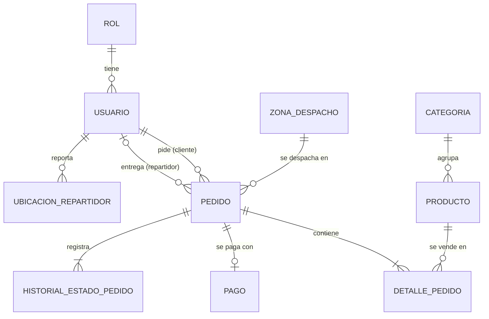

# Gas Gotita — Backend

API REST de **Distribuidora de Gas Gotita** (DSY1104 · Duoc UC · 2026): guarda los datos en PostgreSQL y maneja el inicio de sesión con JWT para el frontend React.

| | |
|---|---|
| Integrantes | Martín Escobar · Rocío Sáez |
| Frontend | https://github.com/martinlabjkpsm-cpu/Distribuidora-de-Gas-Gotita |
| Tecnología | Java 21 · Spring Boot 4.1 · Spring Security (JWT) · JPA · PostgreSQL 18 (AWS RDS) |
| Dónde corre | EC2 `lab-springboot`, puerto 8080 |
| Swagger | `http://localhost:8080/swagger-ui.html` (con el puerto reenviado por VS Code) |

---

## 1. Estado del proyecto

**Listo** = probado en Swagger · **En avance** = programado, falta probar · **Pendiente** = no iniciado

| Módulo | Qué incluye | Estado |
|---|---|---|
| Base de datos | 10 tablas en RDS creadas con `db/01_crear_tablas.sql` | Listo |
| Inicio de sesión | `POST /auth/login` → JWT; error genérico si falla | Listo |
| Registro | `POST /auth/register` → rol CLIENTE asignado por el servidor | Listo |
| Usuarios: listar, ver, modificar, desactivar | `/usuarios` | Listo |
| Usuarios: crear cuenta interna y cambiar rol | `POST /usuarios` · `PATCH /usuarios/{id}/rol` | En avance |
| Catálogo: productos, categorías, zonas | `/productos`, `/categorias`, `/zonas` | En avance |
| Pedidos: crear, listar, detalle, asignar, cambiar estado | `/pedidos` | En avance |
| Frontend conectado a la API (Axios) | login, registro, catálogo, pedidos | Pendiente |
| HTTPS y despliegue permanente (systemd) | `deploy/gotita-backend.service` | Pendiente |

**Fechas:** avance de usuarios (18/11) · CRUD de usuarios completo (22/11) · entrega Parcial 3 (29/11).

**Pruebas del 18/11 en Swagger (usuarios):**

| Prueba | Resultado |
|---|---|
| Login administrador / cliente | 200 con JWT (30 min) y rol correcto |
| Login con clave incorrecta o cuenta desactivada | 401 "RUT o contraseña incorrectos" |
| Login con cuerpo mal formado | 400 |
| Listar usuarios sin token / con token de administrador | 401 / 200 |
| Registro | 201, rol CLIENTE asignado por el servidor |
| Modificar usuario 5 | 200, nombre y teléfono actualizados |
| Modificar usuario inexistente | 404 |
| Desactivar usuario 5 | 204 |
| Cliente consulta la cuenta de otra persona / la suya | 403 / 200 |

---

## 2. Cómo está organizado

```
backend-gotita/
├── db/                     Scripts SQL: 01 crea las tablas, 02 carga datos de ejemplo
├── deploy/                 Servicio systemd para dejar la API siempre activa
├── src/main/java/cl/duoc/backend/
│   ├── controlador/        Rutas HTTP (/api/v1/...) y permisos por rol
│   ├── servicio/           Reglas del negocio (precios, stock, estados, propiedad)
│   ├── repositorio/        Consultas a la base (Spring Data JPA)
│   ├── modelo/             Una clase por tabla
│   ├── dto/                Datos que entran y salen de la API (nunca la contraseña)
│   ├── seguridad/          JWT, BCrypt, CORS, validación de RUT
│   ├── excepcion/          Errores → JSON con 400/401/403/404/409
│   └── config/             Swagger y datos iniciales
└── src/main/resources/application.properties   Configuración (lee variables de entorno)
```

**Recorrido de una solicitud:** React → `controlador` (valida datos y rol) → `servicio` (aplica reglas) → `repositorio` → PostgreSQL → respuesta JSON.

---

## 3. Cómo ejecutarlo

**1. Variables de entorno.** Copiar `.env.example` como `.env.local` y completarlo. `.env.local` **no se sube a Git**.

| Variable | Para qué |
|---|---|
| `DB_URL` | `jdbc:postgresql://<endpoint-rds>:5432/gotita_db?sslmode=require` |
| `DB_USER` / `DB_PASSWORD` | Usuario y contraseña de la base |
| `JWT_SECRET` | Clave para firmar tokens (`openssl rand -base64 48`) |
| `DEMO_PASSWORD` | Contraseña que reciben los usuarios de ejemplo |
| `CORS_ORIGINS` | Origen del frontend (`http://localhost:5173`) |

**2. Crear la base** (solo la primera vez):
```bash
psql "host=<endpoint-rds> dbname=gotita_db user=postgres sslmode=require" -f db/01_crear_tablas.sql
psql "host=<endpoint-rds> dbname=gotita_db user=postgres sslmode=require" -f db/02_datos_ejemplo.sql
```

**3. Arrancar:**
```bash
set -a; source .env.local; set +a
./mvnw clean spring-boot:run
```

**4. Comprobar:** `curl http://localhost:8080/api/v1/estado` → `{"api":"ok","baseDatos":"gotita_db"}` y abrir Swagger.

**Usuarios de ejemplo** (contraseña = `DEMO_PASSWORD`): `11.111.111-1` administrador · `22.222.222-2` operadora · `33.333.333-3` repartidor · `44.444.444-4` cliente.

---

## 4. Endpoints

Todas las rutas empiezan con `/api/v1`. Las protegidas llevan `Authorization: Bearer <token>`.

| Recurso | Rutas | Quién |
|---|---|---|
| Autenticación | `POST /auth/register` · `POST /auth/login` · `GET /auth/me` | Público · Público · Con token |
| Usuarios | `GET /usuarios` · `POST /usuarios` · `PATCH /usuarios/{id}/rol` · `DELETE /usuarios/{id}` | Administrador |
| | `GET /usuarios/{id}` · `PUT /usuarios/{id}` | El propio usuario o administrador |
| Catálogo | `GET /productos` · `GET /productos/{codigo}` · `GET /categorias` · `GET /zonas` | Público |
| | `POST/PUT/DELETE /productos` · `/categorias` | Administrador |
| Pedidos | `POST /pedidos` | Cliente |
| | `GET /pedidos` · `GET /pedidos/{id}` · `GET /pedidos/{id}/historial` | Cada uno ve solo lo suyo |
| | `PATCH /pedidos/{id}/repartidor` | Operadora |
| | `PATCH /pedidos/{id}/estado` | Repartidor (solo sus pedidos) u operadora |

**Códigos de respuesta:** 200/201/204 éxito · 400 datos inválidos · 401 sin token o vencido · 403 sin permiso · 404 no existe · 409 conflicto con una regla.

**Regla de negocio (409):** un pedido pasa a **EN CAMINO** solo si tiene repartidor asignado. También: no se vende más que el stock disponible.

---

## 5. Base de datos

10 tablas en PostgreSQL (AWS RDS, base `gotita_db`). Detalle de columnas y restricciones en [`db/01_crear_tablas.sql`](db/01_crear_tablas.sql).



La API no crea tablas: al arrancar comprueba que el código coincide con la base (`ddl-auto=validate`).

---

## 6. Seguridad

- **Contraseñas:** se guardan con **BCrypt** (costo 12), nunca en texto plano. No se usa MD5 porque es rápido y sin sal.
- **JWT:** firmado con HS256, dura **30 minutos**, contiene el RUT (`sub`) y el rol. La clave vive solo en el servidor.
- **Roles:** el registro siempre crea CLIENTE; solo el administrador cambia roles.
- **Propiedad:** nadie puede ver ni modificar datos de otra persona cambiando el id en la URL (403).
- **Pendiente:** HTTPS.

---

## 7. Próximos pasos

- [x] Probar en Swagger el CRUD de usuarios (18/11)
- [ ] Probar crear cuenta interna y cambiar rol
- [ ] Conectar el login y el registro del frontend con Axios (guía 20)
- [ ] Probar catálogo y pedidos con cada rol
- [ ] Sesión persistente y rutas por rol en el frontend
- [ ] Subir diagramas a Drive y enlazarlos aquí
- [ ] Manual de usuario y documento de integración (entrega 29/11)
